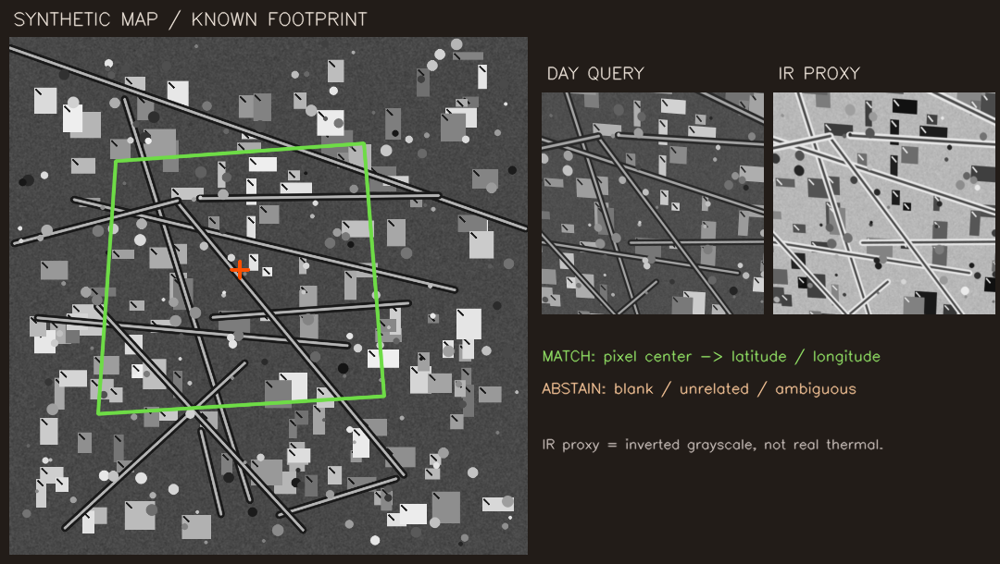
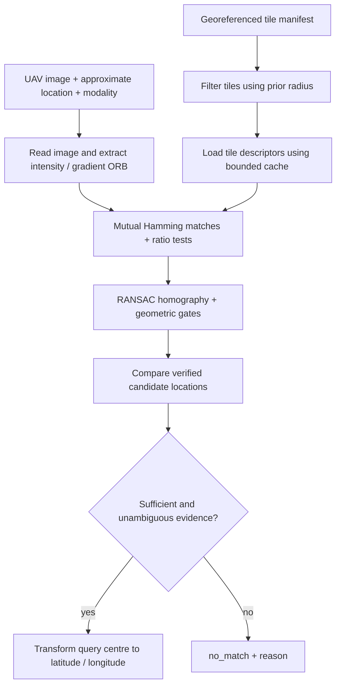

# UAV Visual Geo-Localization — C++ Prototype

A small, offline C++17/OpenCV baseline for the ideaForge UAV Visual Geo-Localisation challenge: find the geographic centre of a UAV image within georeferenced satellite tiles, or return `no_match` when the evidence is weak.

**Prototype status:** working image-matching pipeline, reproducible synthetic demo, automated checks, and a starter Dockerfile. Real EO/IR accuracy, Jetson performance, full-region scalability, and the final competition interface are **not validated**. This is an independent prototype, with no affiliation implied.



## The idea, explained simply

Imagine recognizing a neighbourhood from an aerial photograph. Roads, roof corners, and field boundaries help you identify the same place on a map. This project looks for repeatable image features, checks whether their positions agree geometrically, and converts the estimated image centre into latitude and longitude.

The important design choice is **knowing when to abstain**. A handful of similar-looking corners is insufficient evidence. We require multiple consistent matches spread across the query, a plausible projected footprint, agreement with the approximate location, and no similarly strong result at a different map location.

## Ideation: how the brief became this prototype

The supplied brief describes approximate locations within about 5 km, a large reference region, both daylight EO and thermal IR queries, and an eventual NVIDIA Jetson Orin NX 16 GB deployment. It penalizes confident wrong answers and considers prediction availability and latency. Exact final formats and scoring details are deferred in the brief, so this repository defines a small **provisional CSV interface**.

The reasoning behind the baseline:

1. **Use the available prior.** Filter reference tiles by their geographic intersection with the search circle. The visual matcher then works on plausible tiles, rather than every image in the region.
2. **Start with a method that is easy to explain and inspect.** ORB gives local binary descriptors without training or downloaded model weights. Hamming matching and RANSAC homography estimation provide a compact first implementation. OpenCV documents [ORB](https://docs.opencv.org/4.x/d1/d89/tutorial_py_orb.html) and [feature matching with homography verification](https://docs.opencv.org/4.x/d1/de0/tutorial_py_feature_homography.html).
3. **Treat thermal matching as a separate hypothesis.** Thermal appearance can differ strongly from daylight appearance. Gradient magnitude suppresses brightness polarity, so we also match structural images. This is a starting experiment; real IR-to-EO robustness remains an open problem.
4. **Estimate the image centre, rather than the tile centre.** A homography maps query pixels into the reference image. Transforming the query's centre gives a finer estimate than simply returning a retrieved tile's coordinates.
5. **Make uncertainty visible.** Weak texture, failed geometric verification, conflicting locations, and unreadable images produce explicit reasons. The output retains one row per declared query, including failures.

This baseline deliberately avoids adding model training, GPU inference, a map server, or a GUI before the data contract and matching behaviour are understood. All executable project code and the demo generator are C++.

## Pipeline



Both intensity and gradient branches run for **every** query. IR tries the gradient branch first; EO tries intensity first. The best verified branch per tile proceeds to comparison across tiles. There is no rule that skips all IR images or a whole altitude group.

### What is actually checked

Defaults live in [`include/uavloc/localizer.hpp`](../include/uavloc/localizer.hpp):

| Check | Default |
| --- | --- |
| Processing image size | Longest side at most 1,600 pixels |
| ORB features | Up to 4,000 per image per branch |
| Matching | Hamming distance; ratio below 0.75 in both directions; mutual nearest match |
| RANSAC | 4-pixel threshold, at most 3,000 iterations |
| Geometric support | At least 12 inliers and 45% inlier ratio |
| Spatial support | Query inlier convex hull covers at least 4% of query area |
| Reprojection error | Inlier RMSE at most 3 pixels in the resized reference image |
| Footprint | Finite, convex, no projective horizon crossing; plausible area and bounds |
| Location | Projected centre inside the tile and within the query radius |
| Conflicting tiles | Abstain if a candidate over 100 m away scores at least 90% of the best |

Candidate ranking uses `inliers * inlier_ratio / (1 + rmse_px)`. The reported confidence is `min(1, inliers / 40) * inlier_ratio * exp(-rmse_px / 4)`. It is an **uncalibrated evidence score**, not a probability or an error bound. Thresholds are initial engineering choices, not values tuned on a competition dataset.

Only four reference tiles' descriptor sets are cached by default, using least-recently-used eviction. Reference images are decoded when needed and released after feature extraction. This bounds the descriptor cache; decoding a very large source image can still consume substantial memory. Prepare reasonably sized, overlapping tiles.

## Build and run

Dependencies: C++17 compiler, CMake 3.16+, and OpenCV 4 with `core`, `imgproc`, `imgcodecs`, `features2d`, and `calib3d`. There are no Python requirements, pretrained weights, API keys, or runtime downloads.

On Ubuntu or Ubuntu in Windows Subsystem for Linux:

```bash
sudo apt-get update
sudo apt-get install -y build-essential cmake libopencv-dev
cmake -S . -B build -DCMAKE_BUILD_TYPE=Release
cmake --build build -j2
ctest --test-dir build --output-on-failure
```

Native Windows builds require an OpenCV development installation discoverable by CMake, for example by setting `OpenCV_DIR`. The validated path for this prototype is Linux/WSL.

### Five-minute demo

```bash
# Choose a new directory: the generator refuses to overwrite an existing one.
./build/make_demo demo
./build/uav_localizer demo/reference demo/input demo/results.csv
cat demo/results.csv
```

The generator creates all imagery locally from a fixed seed, plus `truth.csv` outside the input folder. The localizer never reads that truth file. The coordinates are arbitrary synthetic coordinates, with no relationship to a real map.

| Demo input | Expected behaviour |
| --- | --- |
| `day.png` | Match a perspective-warped, brightness-adjusted map view |
| `thermal_proxy.png` | Match a blurred, contrast-inverted view via gradients |
| `blank.png` | `no_match`, insufficient texture |
| `unrelated.png` | `no_match`, no verified match |

**The thermal proxy is inverted grayscale, not a physical thermal simulation or a real IR dataset.** Successful matching on it only demonstrates the structural branch and end-to-end interface.

The observed demo output and validation details are in [`docs/validation.md`](validation.md). Regenerate the demo and inspect `overview.png` when presenting.

## Using your own images

```text
reference/
  tiles.csv
  tile_001.png
input/
  queries.csv
  frame_001.png
results.csv
```

`reference/tiles.csv`:

```csv
file,north,south,east,west
tile_001.png,12.010000,12.000000,77.010000,77.000000
```

`input/queries.csv`:

```csv
file,latitude,longitude,radius_m,modality
frame_001.png,12.006000,77.006000,5000,EO
```

Run:

```bash
./build/uav_localizer reference input results.csv
```

Interface assumptions:

- Bounds use WGS84 degrees at the **outer image edges**. Tiles must already be north-up geographic rectangles, with approximately linear latitude/longitude spacing. A Web Mercator tile or arbitrary GeoTIFF needs proper reprojection/georeferencing first; its four bounds alone do not satisfy this contract.
- Pixel `(x,y)` maps to `latitude = north - (y+0.5)/height * (north-south)` and `longitude = west + (x+0.5)/width * (east-west)`. Using resized dimensions preserves this normalized pixel-centre convention.
- Tile latitude/longitude spans must be positive and at most two degrees; latitude is restricted to `[-85,85]`. Antimeridian-crossing tiles are unsupported. This is a small-tile approximation, not a general GIS engine.
- The prior is a search constraint, never the returned answer. Radius must be in `(0,10000]` metres; the brief's 5 km value is a normal input.
- Modality must be `EO` or `IR`. Images are decoded to 8-bit grayscale, so native 16-bit radiometry is not preserved.
- Paths are relative to their manifest folder, with no `..` components. CSV supports quoted commas and escaped quotes, but no multiline fields. Headers must match exactly. Duplicate query or tile filenames and malformed metadata fail the batch before output is written.
- A missing or unreadable query still gets a `no_match,input_error` row. Missing reference tiles are logged and other shortlisted tiles are attempted. A wholly unreadable shortlist returns `reference_unreadable`.
- The output path must be outside the reference and input folders. Filenames identify rows and locate files; they do not supply visual matching evidence.

Output columns:

```csv
name,status,latitude,longitude,confidence,reason,inliers,inlier_ratio,reprojection_error_px,processing_ms,tile,branch
```

`status` is `matched` or `no_match`. Unmatched coordinates and reprojection error are empty. Diagnostics explain the decision. Exit code `0` means the batch completed, including legitimate abstentions; `1` means a fatal input/output error; `2` means incorrect command usage. No external network services are used by the executable.

## Container starter

```bash
docker build -t uav-localizer .
mkdir -p results
docker run --rm --network none \
  -v "$PWD/demo/reference:/reference:ro" \
  -v "$PWD/demo/input:/input:ro" \
  -v "$PWD/results:/output" \
  uav-localizer /reference /input /output/results.csv
```

The Dockerfile is a portable CPU development starting point. It has **not been built or run on Jetson** and does not claim compliance with the organizer's eventual base image. Build it on the intended ARM64 target, adapt the base to the supplied platform contract, and measure memory and latency there. Package any required data locally; runtime has no download step.

## What to say when presenting

> “Our project estimates the centre location of a UAV image by matching it to a stored satellite map when GNSS is unavailable. We first narrow the map search using the approximate position. We extract ORB features from normalized intensity and gradient images, find corresponding points, and use RANSAC to test whether those points agree with one perspective transformation. We then project the image centre onto the map and convert it to geographic coordinates. Our main design choice is selective prediction: weak texture, inconsistent geometry, or competing locations produce no match. The prototype is written in C++ and runs offline. The synthetic demo verifies the pipeline, including a contrast-inverted proxy, but real thermal robustness and Jetson performance still need evaluation.”

### Demo walkthrough

1. Show the synthetic map and outlined query footprint in the image above.
2. Build and run the four-image demo. Show both matches and both abstentions in the CSV.
3. Explain that RANSAC rejects inconsistent feature correspondences, while our additional gates decide whether to return the estimate.
4. Point to the gradient branch for the IR proxy, then state the limits of that experiment.
5. Close with the next real experiment: EO/IR validation split by modality and altitude, with error, prediction rate, and batch runtime measured together.

### Likely questions

**Why C++?** It keeps the image processing and deployment executable in the requested language and uses OpenCV directly. This version runs on the CPU; GPU acceleration is future work.

**Why can thermal fail?** Thermal and daylight may highlight different physical structures. Gradient images help with some contrast changes but do not make modalities equivalent. Real paired validation is necessary.

**Why return no match?** A wrong absolute fix can be costly. However, abstention alone is insufficient: prediction availability must also be measured for EO, IR, and altitude groups. This repository does not claim that these tradeoffs have been optimized.

**Does it return the drone's exact position?** It returns the geographic centre of the image footprint, as requested by this baseline interface. An off-nadir camera's footprint centre need not equal the UAV's ground position.

## Limitations and next experiments

- No real competition imagery is included or evaluated. No claim of sub-100 m field accuracy is made.
- Homography assumes an approximately planar scene. Relief, parallax, rolling shutter, heavy obliquity, seasonal change, repeated structures, and severe EO/IR appearance differences can break it.
- Only the strongest solution per tile is retained. The ambiguity gate catches competing **tiles**, but repeated patterns within one tile can still produce a false match. Confidence is not calibrated.
- Altitude, attitude, FOV, camera intrinsics, distortion, and terrain models are not consumed yet. They should constrain scale and rectify views when the actual metadata schema arrives.
- The manifest scan is linear in the number of tiles; nearby candidates are matched sequentially. There is no persistent feature index, geographic database, learned retrieval, or throughput guarantee for a 100 km by 100 km region.
- Suggested development sequence: define the official adapter; add overlapping tile preprocessing and a persistent spatial/descriptor index; evaluate with geographically held-out EO/IR data; use supplied camera geometry; compare more robust cross-modal descriptors; calibrate rejection thresholds; then profile the whole batch on Jetson. These are planned experiments, not implemented capabilities.

Track median and tail localization error among accepted estimates, false-fix rate, availability per EO/IR and altitude group, total batch latency, and peak memory. Select thresholds on validation data and hold them fixed for blind evaluation.

## Repository map and licensing

```text
include/uavloc/localizer.hpp   Data types, thresholds, and API
src/localizer.cpp             Matching, verification, cache, and geolocation
src/io.cpp                    CSV contracts and validation
src/main.cpp                  Three-argument batch entry point
tools/                        C++ synthetic imagery and demo generator
tests/test_localizer.cpp      Functional checks, including ambiguity and abstention
docs/validation.md            Recorded local validation and limits
Dockerfile                    CPU container starter
.github/workflows/ci.yml      Build and test on Ubuntu
```

Project code is MIT licensed; OpenCV is a separate dependency with its own license. No pretrained models are used. The supplied brief and competition imagery are not redistributed. Only original code and generated synthetic demonstration assets are published.
